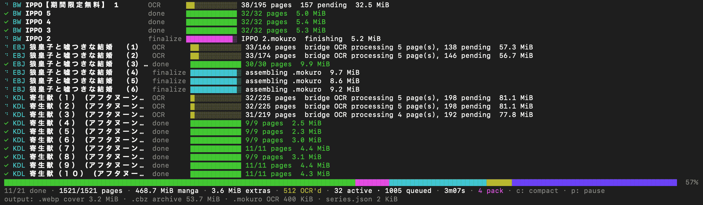

<p align="center"></p>

# 読破 (dokuha-cli) · v1.1.0

<p align="center"><strong>Download manga volumes at the resolution the store serves, with no browser.</strong></p>

<p align="center">MIT · Node.js 20 or newer</p>

[Quick start](#quick-start) · [Install](#install) · [Screenshots](#screenshots) · [Why people use it](#why-people-use-it) · [Supported stores](#supported-stores) · [How it works](#how-it-works) · [Related tools](#related-tools) · [Documentation](#documentation)

dokuha-cli is a browserless Node CLI for BookWalker, CMOA, ebookjapan, Amazon Kindle (JP), k-manga and DMMブックス. Paste a volume URL and it captures the pages through the store's own viewer, rebuilds them offline into a folder of numbered images, and stops there. Paste a series URL with `--series` and it finds the volumes that are free to read in full, then downloads them.

The name comes from the Japanese word 読破, to read a work through to the end, which is what the tool is for: getting a whole run of books onto your own disk, at the size the store serves, without a browser in the loop.

## Quick start

```sh
npm install -g dokuha-cli
dokuha 'https://www.cmoa.jp/title/214001/vol/1/'
```

A whole series, without knowing which volumes are free:

```sh
dokuha --series 'https://www.cmoa.jp/title/214001/'
dokuha --series --download-samplers 'https://ebookjapan.yahoo.co.jp/books/126001/'
```

Free volumes and previews on BookWalker, CMOA, ebookjapan, k-manga and DMMブックス need no account, no cookies and no login. Paid or library titles are opened with cookies you copy from your own browser, and Kindle always needs a session. A DMMブックス 試し読み is a `tachiyomi/` viewer URL of its own: paste it and that one preview downloads without `--series` or `--download-samplers`.

## Install

`dokuha-cli` needs Node 20 or newer. The global install is one command, and the optional `sharp` dependency powers page rebuilding; npm installs it automatically.

```sh
npm install -g dokuha-cli
dokuha --help
```

`dokuha` checks npm for a newer release at most once a day and prints one line when one exists, naming the exact upgrade command. The check never delays a download and stays silent for `--json`, `--quiet` and non-terminal stderr. Run `dokuha --check-update` to ask now (exit 0 current, 1 newer exists, 2 check failed), or `dokuha --update` to upgrade a global npm install. Both refuse to upgrade a git checkout or a local install, where that command would touch the wrong copy.

## Screenshots

<p align="center"></p>

<p align="center"><sub>The live progress block for a mixed run across the stores: one row per volume, with download, OCR and upload stages in a single block, and the totals and output sizes along the bottom. Open the image to read the small text.</sub></p>

## Why people use it

- **Browserless by design.** Every store has a private viewer API, and `dokuha` speaks to it directly. There is no Chrome, no Puppeteer and no DOM, so a run starts fast on a machine that has never had a browser installed and cannot be broken by a frontend redesign.
- **Full resolution.** Pages are written at the size the store serves, not a viewer thumbnail. ebookjapan and DMMブックス pages are rebuilt from the viewer's own shuffle geometry instead of screenshotted.
- **Series aware.** `--series` reads a title page or series page and takes the volumes that are free in full. `--download-samplers` adds each remaining 試し読み preview without ever letting it collide with the whole volume.
- **Resumable.** Finished pages are checkpoints. Re-run the same command and only missing or invalid pages are fetched; `--force` starts over.
- **Parallel where it pays.** Every discovered volume starts at once by default, and the CPU-heavy worker pools share one budget so no single volume takes the machine.
- **Machine-readable.** `--json` prints one summary with per-volume results and a five-phase timing breakdown, so a slow volume can be attributed rather than guessed at. A dry run prints its plan as a table even with `--json`.

## Supported stores

| Store | Host | Free in full | Session | Series walk |
|---|---|---|---|---|
| BookWalker | `bookwalker.jp` | Yes, anonymous | Only for paid or library titles | Yes |
| CMOA | `cmoa.jp` | Yes, anonymous | None | Yes, title listing by probing |
| ebookjapan | `ebookjapan.yahoo.co.jp` | Yes, anonymous | None | Yes |
| Kindle | `amazon.co.jp` | No, every volume needs an account | Always | Yes, one request for the list |
| k-manga | `comic.k-manga.jp` | Yes, anonymous | None | Yes |
| DMMブックス | `book.dmm.com` | Yes, anonymous | None | Yes, `contents_book` listing |

DMMブックス pages are a 64×64 tile shuffle: the optional `sharp` dependency rebuilds them, and without it a DMM run fails with the install line rather than writing shuffled pages. `--no-descramble` keeps the shuffle deliberately.

[docs/stores.md](docs/stores.md) has the URL forms, the per-store limits and the Kindle Unlimited behaviour.

## How it works

```
store URL ──► detect store ──► series walk ──► download lanes ──► volume folder
                                                   │
                                                   └─(optional)─► mokuro-bridge ──► reader library
```

Detection is a registry lookup: each store owns its URL patterns and its adapter, so a mixed batch of URLs from every store can be one command.

Downloading is a two-stage pipeline. A discovered volume first has its pages captured through the store's viewer, rebuilt offline and written to `--out` (default `./library`). Each volume gets its own folder, named after the title, holding `page-0001.jpg` and friends plus a `metadata.json` marker that records which volume owns the folder, so a sampler can never overwrite the book it belongs to. If the run was started with `--mokuro`, the finished folder then moves to a separate bridge stage with its own worker pool and queue, so a volume waiting on OCR never blocks the next download.

The optional hand-off is an HTTP and NDJSON conversation with [mokuro-bridge](https://github.com/GolyBidoof/mokuro-bridge): the CLI opens an OCR session, delivers the pages (a local bridge reads the folder in one request; otherwise the pages are uploaded), then reads the finalize stream for progress until the destination reports a terminal result. OCR happens on the bridge side, where the batched [mokuro fork](https://github.com/GolyBidoof/mokuro) is the recommended engine and upstream mokuro is the slower fallback. The bridge owns that protocol and its documentation; this CLI is one client of it. `dokuha` never reads or writes the destination itself.

## Related tools

`dokuha-cli` is complete on its own. Two other tools can extend it, and neither is required.

- **[dokuha-userscript](https://github.com/GolyBidoof/dokuha-userscript)** is the sister tool in the dokuha family: the same idea, run in a browser instead of a terminal. It downloads the volume you already have open, which is convenient when you are already signed in there. Use it for one title, and the CLI for batches, series and automation.
- **[mokuro-bridge](https://github.com/GolyBidoof/mokuro-bridge)** is a separate, independent service from the mokuro ecosystem. It runs OCR, assembles `.cbz`, `.mokuro` and cover `.webp` files, and delivers them to a folder or a cloud account, publishing a per-series `series.json` that [reader.mokuro.app](https://reader.mokuro.app) reads. It also interoperates with [mokuro-bunko](https://github.com/Gnathonic/mokuro-bunko). Adding `--mokuro` makes `dokuha` a client of that service; without it, nothing about OCR or mokuro-bridge is involved.

## Documentation

| Document | Answers |
| --- | --- |
| [docs/architecture.md](docs/architecture.md) | the platform registry, the schedulers, the page pipeline, the CPU budget, the series walker and the optional bridge hand-off |
| [docs/stores.md](docs/stores.md) | per-store support, URL forms, sessions and known limits |
| [docs/auth.md](docs/auth.md) | BookWalker and Kindle cookies, the state files and how to refresh them |
| [docs/naming.md](docs/naming.md) | how volume folders, series behaviour and page names are derived |
| [docs/performance.md](docs/performance.md) | the measurements behind the defaults, the phase model and the concurrency findings |
| [docs/troubleshooting.md](docs/troubleshooting.md) | the common failures, the exit codes and what each message means |
| [tools/probes/README.md](tools/probes/README.md) | the read-only probes used to measure a store without changing anything |
| [vendor/README.md](vendor/README.md) | the three vendored store engines and every deliberate deviation from upstream |
| [RELEASING.md](RELEASING.md) | the version, the tag and the npm publish |
| [CONTRIBUTING.md](CONTRIBUTING.md) | the contribution rule and the browserless policy checks |
| [CHANGELOG.md](CHANGELOG.md) | what changed, release by release |

## Development

```sh
npm test
```

Thirty-three test files are discovered; thirty-two run offline and one is a live network check that is skipped unless `DOKUHA_TEST_NETWORK=1` is set. The offline suite is hermetic: no network, no credentials, no OCR model, and every title and identifier in the fixtures is invented. `npm run test:acceptance` runs the opt-in live comparison against a store and against the userscript checkout beside this one, and `npm run bench:phases` reproduces the phase table in [docs/performance.md](docs/performance.md).

## Credits and licence

Built by [GolyBidoof](https://github.com/GolyBidoof) with **DeepSeek V4.1 Flash**, an AI coding agent. The agent implemented the driver, the option parser, the store adapters, the progress display and the test suite.

"BookWalker", "CMOA", "ebookjapan", "Kindle", "k-manga" and "DMMブックス" are trademarks of their respective owners. This project is not affiliated with or endorsed by any of them.

For personal, lawful use: download only content you are entitled to access, such as purchased books, free samples and trial chapters. Respect the services' terms of service and the rights of authors and publishers. The maintainer assumes no liability for misuse.

MIT. See [LICENSE](LICENSE).
